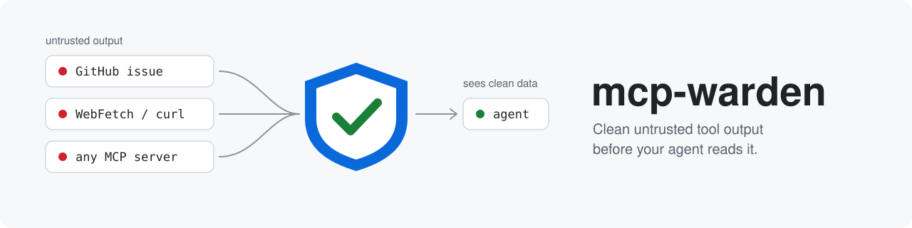
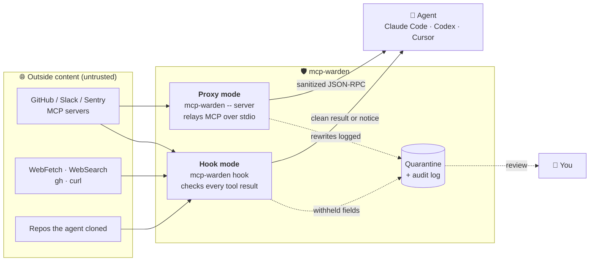
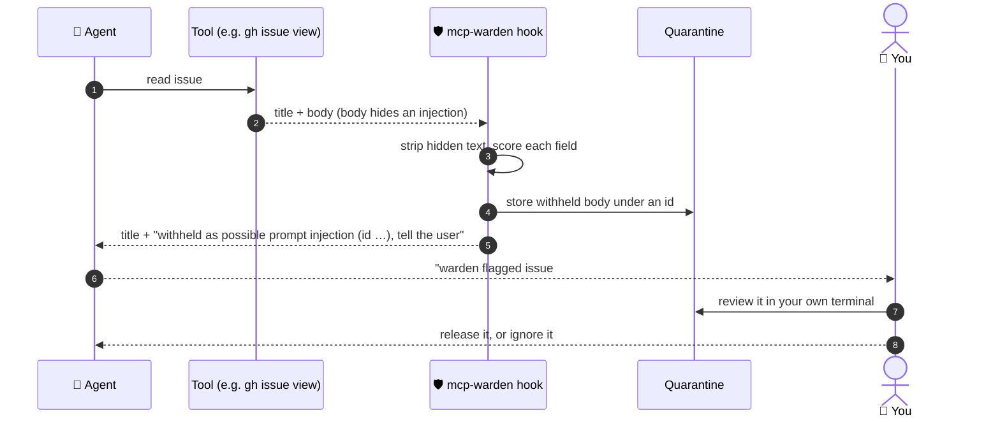
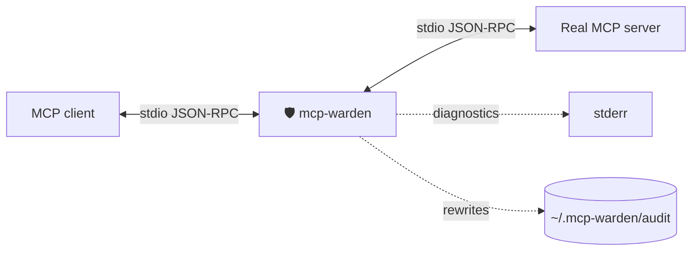
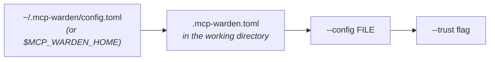

<p align="center">
  
</p>

<p align="center">
  <a href="https://github.com/AncientiCe/mcp-warden/actions/workflows/ci.yml"></a>
  <a href="https://github.com/AncientiCe/mcp-warden/releases/latest"></a>
  <a href="#license"></a>
  
  
  
</p>

<p align="center">
  <b>A local guard that cleans untrusted tool output before your AI agent reads it.</b><br>
  One binary, no service, no account, no network calls of its own.
</p>

<p align="center">
  <a href="#-quick-start">Quick start</a> ·
  <a href="#-install">Install</a> ·
  <a href="#-how-it-works">How it works</a> ·
  <a href="#-protect-every-tool-hooks">Hooks</a> ·
  <a href="#-wrap-an-mcp-server-proxy">Proxy</a> ·
  <a href="#-limits">Limits</a> ·
  <a href="#-faq">FAQ</a>
</p>

---

## 🧭 Why

AI coding agents read text that strangers wrote: GitHub issues, pull requests, web pages, Slack
messages, Sentry events, `curl` output. Any of it can carry **prompt injection**: instructions
aimed at the agent, often hidden where you would never see them (invisible Unicode, HTML
comments, tracking images, bidi tricks).

`mcp-warden` sits between those sources and the agent. It:

- 🧹 **strips content a person would not see**, such as invisible characters, HTML comments and off-host images,
- 🔒 **withholds and quarantines fields that look like injection**, so the agent sees a notice instead of the payload,
- 🏷️ **can label untrusted text** with where it came from,
- 🚦 **can gate sensitive MCP calls** once untrusted content has entered the session,
- 📌 **can pin tool definitions** and warn when a server silently changes them.

Prompt injection is ordinary text, and a filter can always be reworded around. Warden is one layer
of defense, not a sandbox. Keep a sandbox and least-privilege credentials as well (see
[Limits](#-limits)).

## ⚡ Quick start

```bash
# 1. Install (macOS / Linux, see below for Windows and other options)
brew install ancientice/mcp-warden/mcp-warden

# 2. Register the hook in every supported agent client it finds
mcp-warden install

# 3. Restart Claude Code / Codex / Cursor
```

That's it. Every tool result (MCP, web, shell, file reads in cloned repos) is now checked
before the agent reads it. Your own project files and commands are left alone.

## 📦 Install

Prebuilt binaries for Linux, macOS and Windows ship with each
[GitHub release](https://github.com/AncientiCe/mcp-warden/releases). The installers download the
archive for your platform, verify its SHA-256 checksum, and install `mcp-warden`.

| Platform | Command | Installs to |
| --- | --- | --- |
| macOS, Linux (Homebrew) | `brew install ancientice/mcp-warden/mcp-warden` | Homebrew prefix |
| macOS, Linux (script) | `curl -fsSL https://raw.githubusercontent.com/AncientiCe/mcp-warden/main/scripts/install.sh \| sh` | `~/.local/bin` |
| Windows (PowerShell) | `irm https://raw.githubusercontent.com/AncientiCe/mcp-warden/main/scripts/install.ps1 \| iex` | `%LOCALAPPDATA%\Programs\mcp-warden\bin` (added to user `PATH`) |

Set `MCP_WARDEN_VERSION` (for example `v0.3.2`) to pin a release, or `MCP_WARDEN_INSTALL_DIR` to
choose the install directory. Check the install with `mcp-warden --version`.

<details>
<summary><b>Build from source</b></summary>

You need a current stable Rust toolchain (edition 2024). From a checkout:

```bash
cargo build --release --locked
```

The binary is `target/release/mcp-warden` (`target\release\mcp-warden.exe` on Windows). Put that
directory on `PATH`, or point the MCP client at the full path. Warden resolves the wrapped server
through `PATH` / `PATHEXT`, so `npx` works on Windows.

This crate is not published on crates.io. Use `cargo install --path . --locked` from a checkout, or
`cargo install --git https://github.com/AncientiCe/mcp-warden --locked` for the published Git revision.

</details>

## 🔍 How it works

Warden has two modes. Use either or both.



<sub><i>Figure 1. Where warden sits. Hook mode checks tool results inside the agent client; proxy mode wraps one MCP server.</i></sub>

| | 🪝 Hook mode | 🔌 Proxy mode |
| --- | --- | --- |
| Set up with | `mcp-warden install` | `mcp-warden wrap config.json` or a manual config entry |
| Covers | **Every** tool: MCP, WebFetch, WebSearch, Bash, file reads in cloned repos | One stdio MCP server per wrap |
| Clients | Claude Code, Codex, Cursor | Any MCP client that launches stdio servers |
| Suspicious content | Withheld per field and quarantined for your review | Sanitized; optionally labeled, scored and withheld (`--detect`) |
| Action gating | None: no taint, no extra prompts | Optional shared taint (`--enforce`) with single-use approvals |
| Tool pinning | No | Optional (`--pin-tools`) |
| Best for | Day-to-day protection with zero config | Fine-grained policy on specific servers |

## 🪝 Protect every tool (hooks)

```bash
mcp-warden install                 # every supported client found
mcp-warden install claude-code     # or: codex, cursor
mcp-warden install --settings ./.claude/settings.json   # a project's file instead
mcp-warden uninstall               # removes only warden's entries
```

This registers `mcp-warden hook` once for every tool in each supported client it finds:

| Client | Settings file | Notes |
| --- | --- | --- |
| Claude Code | `~/.claude/settings.json` | Cleaned output replaces the original per field. |
| Codex | `~/.codex/hooks.json` | Codex cannot swap in cleaned output, so a flagged result is replaced by the quarantine notice as a whole. Codex asks once, via `/hooks`, to trust the hook. |
| Cursor | `~/.cursor/hooks.json` | Cursor can replace MCP output only; for Shell and Read results the agent is told to treat the flagged output as data and tell you. |

An exact backup of any existing file is written first. Nothing has to be configured per MCP
server. Restart the clients to load the hook.

### What the hook does

After each tool call, the hook checks the result, whatever produced it: `gh issue view` or `curl`
in Bash, WebFetch, WebSearch, or any MCP tool.



<sub><i>Figure 2. A flagged field is withheld; the rest of the result (here, the issue title) still comes through.</i></sub>

- ✅ **Your own project is left alone.** Files, builds, tests and local commands are never flagged,
  even when they contain injection examples.
- 🌐 **Outside content is checked per field.** That means web tools, `gh`/`curl`-style commands,
  and MCP servers whose names point at public sources such as GitHub, Slack, Sentry, Jira or
  browsers. Clean content passes through untouched.
- 👻 **Hidden text is stripped** (invisible characters, HTML comments, off-host images). Ordinary
  markup such as issue-template comments is removed silently; smuggling characters (Unicode tags,
  bidi overrides) are reported by kind, never by content.
- 📥 **Cloned projects start SUSPICIOUS.** Repositories the agent clones (`git clone`,
  `gh repo clone`) are checked like outside content, without prompting. Projects already on disk
  are yours.
- 🔒 **Injection is withheld and quarantined.** The agent sees only a notice with a quarantine id
  and is told to tell you. It is also asked to suggest closing a flagged issue or pull request once
  you have reviewed it, and never to reply or close without your go-ahead.
- 🙈 **The agent cannot unlock the quarantine.** The hook refuses to let the agent run the review
  commands below or read the quarantine directory.

### Commands for you (not the agent)

Run these in your own terminal:

| Command | What it does |
| --- | --- |
| `mcp-warden show ID` | Print withheld content for you to review. |
| `mcp-warden release ID` | Let the agent see it the next time it reads it. |
| `mcp-warden trust DIR` | Treat a project the agent cloned as your own. |
| `mcp-warden distrust DIR` | Check a project's files like outside content again. |

To override the built-in guess for an MCP server, set `default_trust` in
`~/.mcp-warden/config.toml`:

```toml
[servers.my-internal-server]
default_trust = "trusted"     # or "untrusted"
```

## 🔌 Wrap an MCP server (proxy)

`mcp-warden` is also a stdio proxy for [MCP](https://modelcontextprotocol.io) servers. It sits in
front of a server you already run, relays JSON-RPC in both directions, and cleans tool output
before an agent reads it.

```jsonc
// before
{ "command": "github-mcp-server", "args": ["stdio"] }

// after
{ "command": "mcp-warden", "args": ["--server-id", "github", "--", "github-mcp-server", "stdio"] }
```



<sub><i>Figure 3. The client speaks MCP only to warden; warden spawns the real server.</i></sub>

Warden forwards the server's stderr and exit code. Lines that nothing rewrites are forwarded
**byte for byte**, including notifications, non-JSON lines, and requests the server sends to the
client. Diagnostics go to stderr. The protocol stream stays on stdout.

### Wrap a whole client config automatically

```bash
mcp-warden wrap PATH/TO/config.json
```

This wraps stdio entries under `mcpServers` or `servers`, enabling labeling, detection,
enforcement and tool pinning. It prints an exact backup path and lists wrapped/skipped entries.

- Environment settings and original arguments are preserved.
- Repeated runs leave already-wrapped entries unchanged.
- Only strict JSON is accepted; JSON with comments requires manual configuration.
- URL entries are left intact.

Review the generated configuration and restart the MCP client. Restore by copying the reported
backup over the configuration with the client stopped.

### Wrap one server by hand

```text
mcp-warden [OPTIONS] -- <SERVER COMMAND>...
```

Everything after `--` is the real server, unchanged. A client config looks like this:

```json
{
  "mcpServers": {
    "github": {
      "command": "mcp-warden",
      "args": [
        "--server-id", "github",
        "--label",
        "--config", "C:/path/to/trust.toml",
        "--",
        "github-mcp-server", "stdio"
      ]
    }
  }
}
```

### Proxy flags

| Flag | Default | Meaning |
| --- | --- | --- |
| `--server-id ID` | `server` | Name used in stderr and the audit log. Also selects that server's block in `--config`. |
| `--trust untrusted\|trusted` | `untrusted` | `untrusted` applies every sanitizer rule. `trusted` strips only invisible and control characters. |
| `--allow-image-host HOST` | GitHub hosts | Extra image host to leave in place. Repeat the flag to add more. A leading `.` matches subdomains. |
| `--label` | off | Wrap untrusted result text in provenance tags. Off, so benign text stays byte for byte. |
| `--config FILE` | global + project | Additional TOML trust map overriding discovered settings. |
| `--detect` | off | Annotate suspicious untrusted text, and withhold it when the score is high. |
| `--enforce` | off | Gate outbound MCP calls using shared taint, independent of detection. |
| `--state-file PATH` | `~/.mcp-warden/state.json` | Shared taint and single-use approvals. |
| `--pin-tools PATH` | none | Record first-seen tool definitions and warn on changes. |
| `--audit-dir DIR` | `~/.mcp-warden/audit` | Where rewritten messages are logged. `$MCP_WARDEN_HOME/audit` overrides the default home. |
| `--no-audit` | off | Skip the audit log. Sanitizing still runs. |

On Windows, warden puts the server process in a kill-on-close job before spawning it, so the
server tree exits when warden exits, including forced termination.

### Which messages are sanitized

Unknown methods pass through. These responses are sanitized:

| Messages | Rules applied |
| --- | --- |
| `tools/call`, `resources/read`, `prompts/get` | The server's trust level |
| `initialize`, `tools/list`, `prompts/list`, `resources/list`, `resources/templates/list` | Invisible characters only, because that text comes from the server author |
| Server requests `sampling/createMessage`, `elicitation/create` | Sanitized too |
| A response after its request was cancelled, or after the pending map overflowed | Still sanitized; the audit line says `unmatched_response` |

The pending map holds 4096 requests. Image and audio `data`, and resource `blob` bytes, are left
untouched.

## 🧹 What the sanitizer removes

| Rule | Trusted servers | Untrusted servers (default) |
| --- | :---: | :---: |
| Unicode tag characters (the hidden payload is decoded into the audit finding) | ✅ | ✅ |
| Variation-selector smuggling | ✅ | ✅ |
| Zero-width characters ¹ | ✅ | ✅ |
| Bidi overrides | ✅ | ✅ |
| ANSI escapes and other control characters | ✅ | ✅ |
| HTML comments, including an unclosed comment that would hide the rest of the document | | ✅ |
| Markdown and HTML images whose host is not allowlisted ² | | ✅ |
| Base64 or hex runs of 200 characters or more | | ✅ |
| Whitespace padding | | ✅ |

<sub>¹ Keeping real emoji ZWJ sequences, emoji presentation selectors, keycaps, CJK variation
sequences, and ZWJ/ZWNJ in Indic and Persian text.<br>
² Allowed by default: `github.com`, `.github.com`, `.githubusercontent.com`, `.githubassets.com`,
plus any `--allow-image-host`.</sub>

JSON returned as text is parsed and cleaned per string. The message is re-serialized only when
something changed, so a clean result stays byte for byte.

## 🏷️ Trust labels and configuration

`--label` wraps untrusted text:

```text
<untrusted source="github:issue_read" field="$.body">
...
</untrusted>
```

Tag characters in the text are escaped, so a payload cannot forge the closing boundary. Labels
describe where the text came from. They are not an authorization check.

### Config files



<sub><i>Figure 4. Load order. Later sources override earlier ones.</i></sub>

- Later files override a server's supplied `default_trust` and replace its supplied `fields`
  array; omitted settings are inherited. An explicit `--trust` overrides the configured server default.
- Only missing automatically discovered files are ignored. Invalid or unreadable files stop
  startup, including invalid rules for other servers. Unknown keys and unsupported paths fail at
  startup. Unknown server ids stay untrusted.
- ⚠️ **Treat project configuration as security policy**: review `.mcp-warden.toml` before starting
  a client in a downloaded repository.
- Visible labeling still requires `--label`; field and server trust apply even without labeling.
- Offline `scan` uses its command-line options and does not discover these files.

[`examples/trust.toml`](examples/trust.toml) is a starting map, not a statement that any server or
field is safe. Read it before you use it: the `impact` block is `trusted` except for a few
outsider-controlled fields, which is only appropriate when you control that server.

### Field rules

- Rules select tools by exact name. `"*"` selects every tool.
- Paths support `$`, dotted keys, numeric indexes, `[*]`, and descendant keys such as `$..body`.
- An explicit untrusted path wins over a trusted path on the same field.
- `dynamic_trust` looks at one field on the enclosing record, for example `$.author_association`.
  A member's issue does not make its comments trusted. Bots stay untrusted (`user.type` of `Bot`,
  or a login ending in `[bot]`). Semi-trusted text skips the provenance tag and is still sanitized.

## 🔎 Heuristic detection

`--detect` is off unless you pass it. With it on, untrusted text is scored locally after the
sanitizer runs:

| Score | Result |
| --- | --- |
| below 0.5 | Forwarded unchanged (byte for byte when nothing else changed) |
| 0.5 or more | Text kept, prefixed with an annotation naming the rule ids |
| 0.9 or more | Field replaced with a withheld notice; the original is not sent to the client. The audit log records a truncated payload. |

The rules look for instruction overrides, role markers, suspicious commands, exfiltration hints,
secret paths, concealment, and attempts to plant persistent memory. They also probe a bounded
amount of base64. **Rewording defeats them.**

Measure the checked-in corpora with:

```bash
mcp-warden replay tests/corpus
```

The directory must contain `malicious.json` and `benign.json`. The command prints one JSON object
with case counts, true positives, false positives, recall, precision, and latency percentiles. It
always runs with detection enabled. The checked-in corpus is small (tens of cases), so treat its
numbers as a regression check, not a benchmark.

## 🚦 MCP action control

Add `--enforce` to every wrapped server to share taint and gate subsequent sensitive calls.

Taint only goes up during a session, to the highest level any response reaches:

| Level | Raised when |
| --- | --- |
| `clean` | Nothing untrusted has been seen |
| `tainted` | Any untrusted response arrives, even with `--detect` off |
| `suspicious` | A detection score reaches 0.5 |
| `hostile` | A detection score reaches 0.75 |

The stricter the level, the more sensitive calls are asked about or denied. With `--pin-tools`, a
pinned tool definition that changes, or a high-scoring description also raises taint. `mcp-warden untaint`
resets it after review, and state expires after two hours of inactivity.

- **Shared scope.** All instances use `~/.mcp-warden/state.json` (or `$MCP_WARDEN_HOME/state.json`)
  unless `--state-file PATH` selects a separate one. This intentionally shares taint across
  clients; use one explicit path per client session when isolation is required.
- **What is gated.** Read/search calls remain allowed. Secret reads, external fetches, publishing,
  workflow/config changes, destructive actions and unknown tool semantics receive confirmation or
  denial according to taint. Tool classification uses known names and argument paths, not
  server-provided safety annotations.
- **Egress allowlist.** The initial allowlist is `github.com`, `api.github.com`, `crates.io`,
  `docs.rs`, `registry.npmjs.org` and `pypi.org`; only exact parsed hosts match. This does not
  police redirects or the server's network behavior.

### Approving a blocked call

Blocked tool calls return `isError: true`, a reason, and (when confirmation is permitted) an
`_meta["mcp-warden/approval_token"]`.

| Command | What it does |
| --- | --- |
| `mcp-warden approve TOKEN` | Authorize that exact call once (use the same `--state-file`), then retry it. |
| `mcp-warden status` | Show taint and pending approvals as JSON. |
| `mcp-warden untaint` | Clear taint and approvals after review. |

Approval expires after ten minutes and is single-use; changing the server, tool, arguments, or
escalating taint invalidates it. Review the requested call before approving. State expires after
two hours of inactivity.

> [!WARNING]
> Enforcement covers MCP traffic through warden. Built-in terminal/file/browser tools bypass it,
> and direct access to the state file or approval CLI must stay under human/client control. Do not
> grant an agent unrestricted approval authority. Unknown tool names require confirmation after
> taint; add support deliberately rather than trusting arbitrary `readOnlyHint` claims.

### Custom egress allowlist

To replace the default outbound host exemptions, add this to a loaded TOML configuration:

```toml
[egress]
allow_hosts = ["docs.example.org", "api.github.com"]
```

Hosts match exactly, case-insensitively. Subdomains require their own entries; URLs, ports,
wildcards, and credentials are rejected in this list. An empty list removes every exemption.
Credential-bearing and non-HTTP URLs remain subject to the other-egress policy. Warden checks MCP
arguments; the wrapped server's redirects and later network activity still require a sandbox.

## 📌 Tool definition pinning

`--pin-tools PATH` keeps first-seen fingerprints of tool definitions. Changed definitions gain a
warning and an audit finding; the original fingerprint is retained.

- Review a server upgrade before manually removing its pin file to establish a new baseline.
- Keep the pin file outside agent-writable locations where possible.
- This is trust on first use: it cannot attest that the first definition was safe.
- `--detect` additionally scans tool descriptions. With `--enforce`, a changed definition or
  high-scoring description raises shared taint before the client sees it.

## 📄 Scan a file offline

`mcp-warden scan` runs the same sanitizer outside a live session. Clean text goes to stdout.
Findings go to stderr as JSON lines. Omit the path to read stdin. The input must be UTF-8.

```bash
mcp-warden scan notes.md
mcp-warden scan --fail-on-findings --detect notes.md
```

| Exit code | Meaning |
| --- | --- |
| `0` | Success |
| `1` | Error |
| `3` | `--fail-on-findings` and something was found |

The same `--trust`, `--allow-image-host`, and `--detect` flags apply. `--label` is a proxy flag;
`scan` does not add provenance tags. This makes `scan` usable in CI to check docs or fixtures.

## 🧾 Audit log

Each rewritten message appends one JSON line to `~/.mcp-warden/audit/YYYY-MM-DD.jsonl` (UTC). The
line has the server id, method, tool, trust level, findings (including a decoded hidden payload
when there is one), and SHA-256 of the message body before and after. Stderr gets a one-line
summary.

Files older than 30 days are deleted the next time warden starts.

> [!CAUTION]
> The log can contain whatever the server returned, including secrets that were hidden in the
> content. Keep that directory private to your user. See [SECURITY.md](SECURITY.md).

## 🗂️ Files and locations

`$MCP_WARDEN_HOME` replaces `~/.mcp-warden` everywhere below.

| Path | Purpose |
| --- | --- |
| `~/.mcp-warden/config.toml` | Global trust map and egress settings |
| `.mcp-warden.toml` | Per-project trust map (working directory of the proxy) |
| `~/.mcp-warden/state.json` | Shared taint and single-use approvals (`--enforce`) |
| `~/.mcp-warden/audit/` | Daily JSONL audit logs, kept 30 days |
| `~/.mcp-warden/quarantine/` | Content the hook withheld, for `show` / `release` |
| `~/.mcp-warden/projects.json` | Which cloned projects are suspicious or trusted |

## ⚠️ Limits

Be clear about what warden is and is not:

- 🧱 **Not a sandbox.** It does not restrict what a process can do. Keep a sandbox and
  least-privilege credentials.
- ✍️ **Detection is heuristic.** Rewording defeats it. Stripping hidden content is the
  reliable part; scoring is a bonus.
- 🔌 **The proxy alone sees only MCP traffic on stdio.** A client tool that runs a shell, fetches a
  URL, or reads a file never passes through it. Use the hooks to cover those.
- 🌐 **HTTP and SSE transports are not implemented** for the proxy.
- 🔓 **Trust is your call.** Marking a server `--trust trusted`, or a field trusted in the config,
  turns off the untrusted rules for that text.
- 🎚️ **Proxy extras are opt-in.** `--detect` and `--label` are optional. The default proxy only
  strips the hidden-content rules above.
- 🚦 **Action blocking requires `--enforce` on every participating server**; unwrapped and built-in
  tools bypass it.

## ❓ FAQ

<details>
<summary><b>Will it break my normal work?</b></summary>

It is designed not to. Clean content is forwarded byte for byte, your own project files and local
commands are never flagged, and the hook stays silent unless it withholds injection or removes
smuggling characters. The test suite checks that benign traffic passes through unchanged.

</details>

<details>
<summary><b>Does it send my data anywhere?</b></summary>

No. Warden runs locally, scores text locally, and writes only to `~/.mcp-warden` (or
`$MCP_WARDEN_HOME`) and your client's settings file when you run `install`.

</details>

<details>
<summary><b>Do I need the hooks, the proxy, or both?</b></summary>

Start with `mcp-warden install` (hooks). It covers every tool with no per-server setup. Add the
proxy for servers where you want field-level trust maps, provenance labels, tool pinning, or
taint-based action gating.

</details>

<details>
<summary><b>The agent says something was withheld. What now?</b></summary>

Run `mcp-warden show ID` in your own terminal and read it. If it is harmless, `mcp-warden release
ID` lets the agent see it on its next read. If it is an injection attempt, consider closing or
reporting the issue or pull request it came from.

</details>

<details>
<summary><b>Why can't the agent run <code>show</code> or <code>release</code> itself?</b></summary>

Because an injected instruction could tell it to. Review stays with you; the hook denies those
commands and reads of the quarantine directory when the agent tries them.

</details>

<details>
<summary><b>How do I undo the install?</b></summary>

`mcp-warden uninstall` removes only warden's hook entries and keeps all other settings. The
original file was also backed up when you installed.

</details>

## 🛠️ Development

Behavior is tested by running the `mcp-warden` binary against
[`examples/fake_server.rs`](examples/fake_server.rs) and the corpora in
[`tests/corpus/`](tests/corpus). [`AGENTS.md`](AGENTS.md) is the working agreement for this
repository (behavior-test TDD, quality gates, proxy discipline).

The gate suite is formatting, Clippy, `cargo audit`, `cargo test --workspace`, and
`cargo build --workspace --locked`.

```bash
make check                 # Linux and macOS
pwsh scripts/check.ps1     # Windows
```

GitHub Actions ([`.github/workflows/ci.yml`](.github/workflows/ci.yml)) runs those gates on every
push and pull request. Tests run on Linux, macOS and Windows.

## 🤝 Contributing

Issues and pull requests are welcome. Before opening a pull request:

1. Read [`AGENTS.md`](AGENTS.md). New behavior needs a failing behavior test first.
2. Run the full gate suite (`make check` or `pwsh scripts/check.ps1`).
3. Add an entry under `## [Unreleased]` in [`CHANGELOG.md`](CHANGELOG.md).

Found a payload that slips through? A new case for `tests/corpus/malicious.json` (or a benign
case that gets flagged, for `benign.json`) is one of the most useful contributions.

## 🔐 Security

Report a vulnerability in private. The threat model, operator assumptions, and contact path are in
[SECURITY.md](SECURITY.md).

## 📜 License

Licensed under either of

- MIT license ([LICENSE-MIT](LICENSE-MIT) or https://opensource.org/licenses/MIT)
- Apache License, Version 2.0 ([LICENSE-APACHE](LICENSE-APACHE) or https://www.apache.org/licenses/LICENSE-2.0)

at your option.
